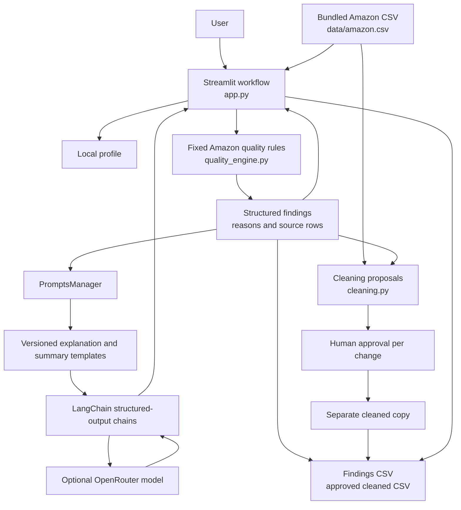
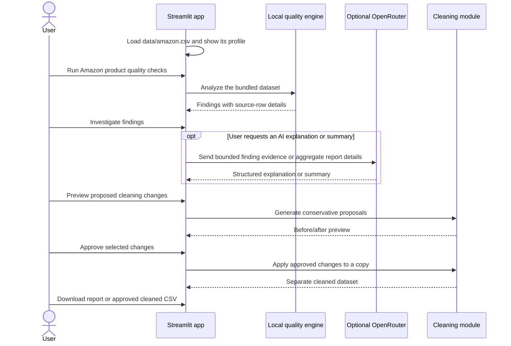

# Amazon Data Quality Investigator

A Streamlit app for profiling the bundled Amazon product CSV, running a fixed
set of local data-quality rules, investigating row-level findings, previewing
human-approved cleaning changes, and exporting reports.

The app is intentionally scoped to `data/amazon.csv`: there is no dataset
uploader, dataset selector, or AI-generated validation plan. The quality engine
always runs its Amazon-specific checks. Optional OpenRouter calls are only used
to explain a selected finding or summarize a completed report.

## Architecture



### Workflow



The four workflow stages are **Overview**, **Investigate**, **Clean data**, and
**Export**. Validation is deterministic and local; it does not call an LLM.
Cleaning proposals do not change the original CSV. The app only creates a
separate cleaned copy after explicit approval.

## Amazon-specific checks

The Overview lists the checks that the engine applies when **Run Amazon product
quality checks** is clicked:

1. Missing and blank values
2. Exact duplicate rows
3. Invalid numeric values
4. Ratings outside the 0–5 range
5. Discount percentages outside the 0–100 range
6. Zero or negative prices
7. Discounted prices exceeding actual prices
8. Inconsistent discount calculations
9. Missing product identifiers
10. Repeated product IDs, reported separately for investigation

Repeated product IDs are review findings, not proof of duplicate products.
Validation reports issues and does not modify or remove source records.

## Setup

Python 3.10 or later is recommended. From the repository root, create and
activate one virtual environment and install the dependencies:

### macOS / Linux

```bash
python3 -m venv .venv
source .venv/bin/activate
python -m pip install --upgrade pip
pip install -r requirements.txt
```

### Windows PowerShell

```powershell
py -m venv .venv
.\.venv\Scripts\Activate.ps1
python -m pip install --upgrade pip
pip install -r requirements.txt
```

Run the app:

```bash
streamlit run app.py
```

The fixed input file is `data/amazon.csv`. No upload or alternate dataset
selection is available.

## Optional AI explanations and summaries

The local quality checks work without OpenRouter credentials. To enable AI
finding explanations and report summaries, create a `.env` file from the sample
and set an OpenRouter key:

```bash
cp .env.example .env
```

```dotenv
OPENROUTER_API_KEY=your-openrouter-api-key
OPENROUTER_MODEL=openrouter/free
```

Keep `.env` private; it is excluded from Git. The configured model is used only
when the user clicks one of the optional AI explanation or summary actions.

AI input boundaries:

- Finding explanations include up to five issue examples and only relevant
  evidence fields.
- Report summaries include aggregate finding details, not individual row
  records.
- These requests send data to the configured OpenRouter model. Follow your
  organization's data-handling policies before enabling AI features.
- Provider/model availability and quotas are controlled by OpenRouter; free
  routing does not guarantee availability.

## Cleaning and exports

The **Clean data** stage presents conservative suggestions, including
normalizing blank strings to missing values, replacing unparseable Amazon
numeric-field values with missing values, and trimming surrounding whitespace
where allowed. It does not infer replacement values or automatically correct
prices, ratings, identifiers, or duplicate rows.

Select the proposed edits you want and choose **Apply approved changes**. The
app applies them to a deep copy; the original dataset remains unchanged.

The **Export** stage provides:

- A findings CSV after the quality engine has run.
- A cleaned CSV only after at least one proposed change has been approved and
  applied.

## Project layout

```text
.
├── app.py                    # Streamlit UI and workflow
├── data/
│   └── amazon.csv            # Fixed example and analysis dataset
├── src/
│   ├── cleaning.py           # Proposed changes and approved-copy application
│   ├── inspect_data.py       # Command-line dataset inspection helper
│   ├── llm.py                # Optional OpenRouter configuration
│   ├── prompt_chains.py      # Explanation and report-summary chains
│   ├── prompt_schemas.py     # Structured AI output schemas
│   ├── prompt_templates.py   # Versioned explanation and summary prompts
│   ├── prompts_manager.py    # Bounded evidence preparation and AI calls
│   └── quality_engine.py     # Amazon-specific deterministic checks
├── tests/                    # Unit and Streamlit AppTest coverage
├── .env.example
├── requirements.txt
└── README.md
```

## Tests

With the project virtual environment active:

```bash
pytest -q
```

Tests use fake model responses and do not require an OpenRouter API key or make
live model calls.
