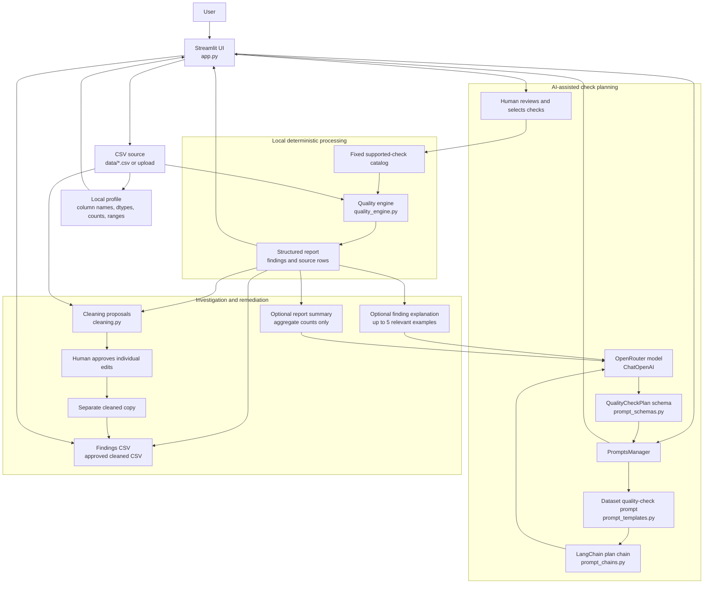
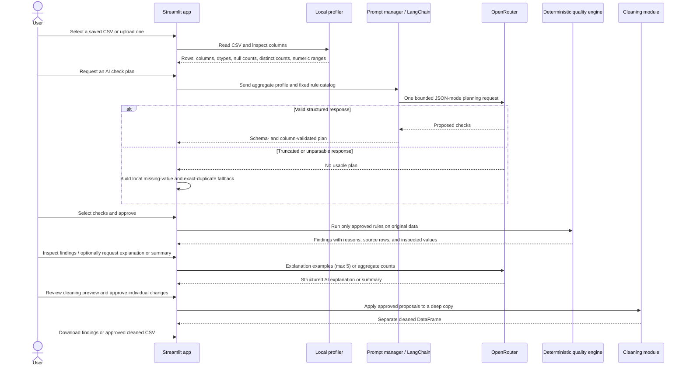

# Data Quality Investigator

A Streamlit application for exploring CSV datasets, proposing relevant quality
checks with OpenRouter, reviewing those checks, and investigating findings. The
checks themselves run locally and deterministically. Validation never changes
the source dataset; cleaning suggestions are a separate, human-approved flow.

## Contents

- [Architecture](#architecture)
- [Workflow](#workflow)
- [Supported checks](#supported-checks)
- [Setup](#setup)
- [Using the app](#using-the-app)
- [AI, privacy, and request limits](#ai-privacy-and-request-limits)
- [Cleaning and exports](#cleaning-and-exports)
- [Project layout](#project-layout)
- [Tests](#tests)
- [Troubleshooting](#troubleshooting)

## Architecture

The app separates the Streamlit interface, prompt orchestration, reusable
prompt templates, structured response schemas, deterministic checks, and
cleaning operations.



### Component responsibilities

| Component | Responsibility |
| --- | --- |
| [`app.py`](./app.py) | Dataset selection/upload, local profiling, workflow UI, explicit approval gates, and downloads. |
| [`src/llm.py`](./src/llm.py) | Creates the LangChain `ChatOpenAI` client pointed at OpenRouter and checks local API-key configuration. |
| [`src/prompt_templates.py`](./src/prompt_templates.py) | Versioned prompt text for check planning, finding explanations, and report summaries. |
| [`src/prompt_chains.py`](./src/prompt_chains.py) | Builds typed LangChain prompt/model/parser pipelines. |
| [`src/prompt_schemas.py`](./src/prompt_schemas.py) | Pydantic schemas that constrain model outputs and check parameters. |
| [`src/prompts_manager.py`](./src/prompts_manager.py) | Builds aggregate dataset profiles, invokes prompt chains, validates proposed columns, and prepares bounded explanation evidence. |
| [`src/quality_engine.py`](./src/quality_engine.py) | Implements the fixed deterministic check catalog and returns structured findings without mutating input data. |
| [`src/cleaning.py`](./src/cleaning.py) | Creates conservative cell-level cleaning proposals and applies approved proposals to a copy. |
| [`tests/`](./tests) | Unit and Streamlit AppTest coverage for checks, prompts, approval, cleaning, and exports. |

The app keeps workflow state in Streamlit session state. A hash of the selected
CSV bytes is used to clear the previous plan, validation report, explanations,
and cleaning approvals when the dataset changes.

## Workflow



In the UI, the workflow is split into four stages:

1. **Overview** — choose a dataset, inspect its profile, request a proposed
   check plan, and explicitly approve the checks to run.
2. **Investigate** — review findings and source records. AI explanations and
   summaries are optional.
3. **Clean data** — review suggested changes, select specific edits, and apply
   only those approvals to a separate copy.
4. **Export** — download the findings report and, only if changes were
   approved, the cleaned dataset.

## Supported checks

The model cannot write or execute validation code. It may only select from
these checks implemented in the local engine:

| Check | What it reports | Parameters / notes |
| --- | --- | --- |
| Missing or blank values | Rows with missing or whitespace-only values in selected columns. | May group multiple columns. |
| Exact duplicate rows | Rows identical across all selected columns. | This reports rows; it does not remove them. |
| Invalid numeric values | Non-empty values that cannot be parsed as numbers. | May group numeric columns. |
| Numeric range | Numeric values outside inclusive bounds. | Exactly one column per check; bounds are shown for human review. |
| Positive numeric | Zero or negative numeric values. | May group fields with the same meaning; an optional minimum of zero is accepted. |
| Repeated values | Repeated non-blank values, for investigation. | Repetition is not automatically an error or proof of duplicate entities. |

Each proposed column must exist in the selected dataset. Plan output is checked
against a Pydantic schema, restricted to at most five checks, and displayed for
human review. The engine runs only checks the user selects and approves.

The quality engine also retains a legacy Amazon-specific validation mode for
existing direct callers: call `analyze_dataset(data)` without a `checks`
argument to use that preset. The Streamlit app instead runs the explicitly
approved generic checks.

## Setup

Python 3.10 or later is recommended. Use a single virtual environment in the
project root:

### macOS / Linux

```bash
python3 -m venv .venv
source .venv/bin/activate
python -m pip install --upgrade pip
pip install -r requirements.txt
cp .env.example .env
```

### Windows PowerShell

```powershell
py -m venv .venv
.\.venv\Scripts\Activate.ps1
python -m pip install --upgrade pip
pip install -r requirements.txt
Copy-Item .env.example .env
```

Add your OpenRouter key to `.env`:

```dotenv
OPENROUTER_API_KEY=your-openrouter-api-key
OPENROUTER_MODEL=openrouter/free
```

Keep `.env` private; it is excluded from Git. The app uses the configured
`OPENROUTER_MODEL`, or `openrouter/free` if it is unset.

Start the app from the repository root:

```bash
streamlit run app.py
```

The default saved dataset is `data/amazon.csv`. Other CSV files under `data/`
are available in the dataset selector; choose **Upload a CSV…** to use a CSV
from elsewhere. Uploaded bytes are read by the running Streamlit app and are
not written by the app into the project’s `data/` directory.

## Using the app

### 1. Select or upload a dataset

Use the **Dataset** selector to choose an available CSV, or select
**Upload a CSV…** and choose a file. The Overview displays a preview, row and
column counts, and a column profile including inferred type, non-missing
count, and distinct count.

### 2. Generate and review a check plan

Choose **Generate AI check plan**. The request contains the column names,
inferred data types, row/non-missing/distinct counts, parseable numeric counts,
and finite numeric minimum/maximum values. It does not include sample records
or raw cell values during planning.

Review every proposal, including its columns, rationale, deterministic rule
description, and any range bounds. Checks are initially unselected. Select the
checks you want and choose **Approve selected checks and run**. Without this
approval, no quality checks run.

If the model response is truncated or cannot be parsed, the app does not retry.
It offers a clearly labeled local fallback plan containing missing-value and
exact-duplicate checks across the dataset columns. The fallback also requires
explicit approval. Other API/configuration errors are surfaced rather than
silently treated as successful plan generation.

### 3. Investigate findings

Open **Investigate** to review affected-row counts and findings. Select a
finding to inspect its source rows, reason, and values from the checked columns.
Details are paginated in the UI.

Optional AI actions:

- **Explain finding and recommend a fix** sends up to five examples restricted
  to the selected check fields for that finding.
- **Summarize report with AI** sends aggregate dataset and finding information,
  not individual source-row records.

### 4. Preview and approve cleaning

Open **Clean data** to review proposed cell-level edits. The current conservative
proposals can normalize blank strings to missing values, replace unparseable
values in selected numeric fields with missing values, and trim surrounding
whitespace where allowed. They do not infer replacement values or automatically
correct ranges, prices, identifiers, or duplicates.

Select individual rows in the approval column, then choose **Apply approved
changes**. The changes are applied to a deep copy; the source dataset is left
unchanged. Changing the selection requires applying the changes again.

### 5. Export

Open **Export** to download a findings CSV. A cleaned CSV download appears only
after at least one cleaning proposal has been approved and applied. Downloads
use the selected dataset's filename as their prefix.

## AI, privacy, and request limits

- The deterministic engine, profiler, cleaning proposal generator, and export
  code run locally.
- AI is used only when a user requests a check plan, finding explanation, or
  report summary.
- Plan generation is configured as one JSON-mode request with a 1,200-token
  output cap, minimal reasoning effort, and no automatic client retries. The
  prompt asks for at most five checks.
- If the plan is truncated or unparseable, the app uses the local fallback
  rather than making an automatic second request.
- Explanations send at most five issue examples and only the relevant evidence
  fields. For the generic approved-check workflow, these are the selected check
  fields. Summaries send aggregate finding information, not individual
  source-row records.
- Dataset content sent to OpenRouter leaves the local process. Do not upload
  sensitive or regulated data unless your organization's data-handling policy
  allows using the configured provider/model.
- OpenRouter free-model availability, request quotas, model behavior, and
  provider-side token handling are controlled by OpenRouter and the selected
  model; the app cannot guarantee a request will succeed or be free.

## Project layout

```text
.
├── app.py                    # Streamlit UI and workflow orchestration
├── data/
│   └── amazon.csv            # Included example dataset
├── src/
│   ├── cleaning.py           # Cleaning proposals and approved-copy application
│   ├── inspect_data.py       # Command-line inspection helper for the example CSV
│   ├── llm.py                # OpenRouter model configuration
│   ├── prompt_chains.py      # LangChain runnables and structured parsers
│   ├── prompt_schemas.py     # Pydantic request/response schemas
│   ├── prompt_templates.py   # Versioned prompt templates
│   ├── prompts_manager.py    # Prompt context preparation and plan validation
│   └── quality_engine.py     # Deterministic checks and finding data structures
├── tests/
│   ├── test_app.py
│   ├── test_cleaning.py
│   ├── test_llm.py
│   ├── test_prompts_manager.py
│   └── test_quality_engine.py
├── .env.example              # OpenRouter configuration template
├── requirements.txt
└── README.md
```

## Tests

Activate the project virtual environment, then run:

```bash
pytest -q
```

Tests use fake LangChain models and Streamlit AppTest where practical. They do
not need an OpenRouter API key or make live model calls.

## Troubleshooting

### AI planning is disabled

Set a valid `OPENROUTER_API_KEY` in `.env`, restart or rerun Streamlit, and
confirm the selected model is available to your OpenRouter account.

### A local fallback plan is displayed

The model output was truncated or did not match the structured schema. No
automatic retry was made. Review the conservative fallback rules and approve
only what you want to run, or make another explicit attempt to generate a plan.

### A dataset does not appear in the selector

Saved datasets must be CSV files under the project's `data/` directory (nested
directories are searched). Otherwise choose **Upload a CSV…**.

### Findings or approvals disappeared after changing datasets

This is expected: changing the dataset content resets prior plans, reports,
cleaning proposals, and approvals so results cannot accidentally carry over to
a different source file.
